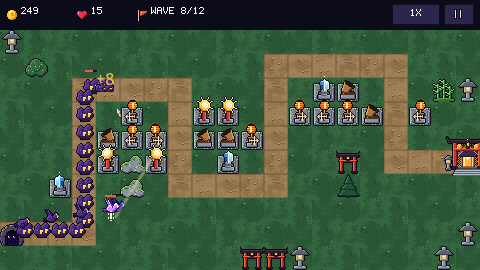

# Godot Tower Defense: a CodePlate template

> **Free CodePlate template, v1.2.5.** This repository mirrors the zip on [codeplate.io](https://codeplate.io/t/godot-tower-defense/).
> Press **Use this template** to start your own repository from it, or [download the zip](https://codeplate.io/t/godot-tower-defense/).
> [All templates](https://codeplate.io/) · [Free License](https://codeplate.io/license/free/) · subscribers get it under the [Pro License](https://codeplate.io/license/pro/) with no credit.

A complete tower defense game for **Godot 4.7**, built so your AI agent can turn it into *your* game.



## What's inside

- **"Lantern Keep":** paper-lantern towers guard a mountain shrine from creeping shadows, across 6 levels with stars.
- **4 towers, 3 levels each:** quick arrows, a splash mortar, a frost lantern that slows, and a long sun ray that ignores armor. Upgrade, sell, and pick a target mode (first, last, strongest, closest).
- **7 enemies:** grunts, fast runners, armored beetles, flyers that skip the path, splitters, and a boss.
- **Waves:** a countdown between waves, with bonus gold for calling the next one early.
- **Feel:** 1×/2×/3× speed (any speeds, fractions included), range rings, hit and splash effects, gold popups, shake on leaks.
- **Controls:** mouse, touch and keyboard shortcuts.
- **Progress:** saved stars, and each level unlocks the next.
- **Settings and credits:** music and effects volume, fullscreen, reset progress, and a credits page.
- **Content as data:** maps are plain **ASCII text**; towers, enemies and waves are **JSON**. It's the easiest content for an agent to edit.
- **Free to ship:** original pixel art, sound effects and music.

## For your agent

- `AGENTS.md`: the brief, with 12 step-by-step recipes (including more spawns and paths per map) and a full content reference.
- A deterministic battle core with no nodes, and 35 headless checks covering every rule.
- **A balance bot.** It plays every level, and the checks fail if a level can't be won with lives to spare, or can be won without building anything.
- Map validation that names the row and column of any mistake.
- A screenshot tool that fast-forwards into a battle, so the agent can see what it changed.

## Use it with your agent

1. Unzip this folder where your project will live.
2. Install [Godot 4.7](https://godotengine.org/download).
3. Open the folder with your agent and say something like:

   > This is a tower defense template. Read AGENTS.md, then let's make it mine: a candy castle defended from ants, with a gumdrop cannon and a licorice whip tower.

## Run it yourself

```
godot --path .
```

## How this template was made

This template was written largely by AI coding agents (Claude, by Anthropic). IASoft reviewed and tested the work. The template's checks run on every change. To test it, a fresh agent was given a made-up project and a set of change requests to carry out with the template. The record of that run is at [codeplate.io/t/godot-tower-defense/eval/](https://codeplate.io/t/godot-tower-defense/eval/).

## License

You can use, modify and ship games made from this template, including commercially. Games you share must credit "Built with CodePlate (codeplate.io)" (in the credits, or the store page or docs). You can't resell the template itself. See [LICENSE.md](LICENSE.md). The placeholder assets are listed in `assets.json` and [CREDITS.md](CREDITS.md).

Made by [CodePlate](https://codeplate.io).
